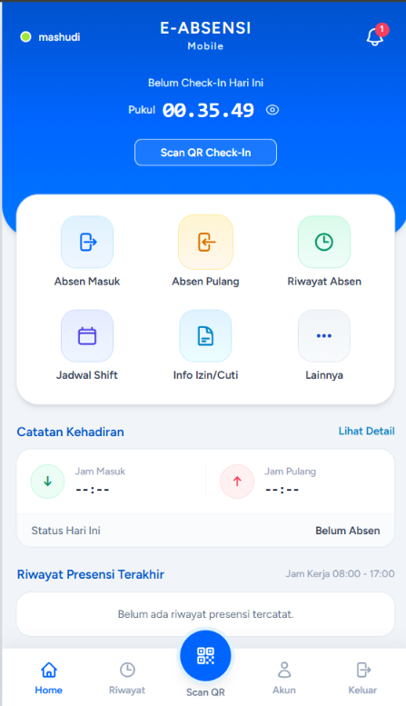

# 📱 E-Absensi (Open Source Boilerplate)

<p align="center">
  
</p>

<p align="center">
  <strong>Sistem Presensi Kehadiran Online Modern berbasis QR Code & Validasi Radius Geolocation (Maps GPS)</strong>
</p>

<p align="center">
  <a href="https://laravel.com"></a>
  <a href="https://react.dev"></a>
  <a href="https://inertiajs.com"></a>
  <a href="https://tailwindcss.com"></a>
  <a href="#pwa-progressive-web-app"></a>
  <a href="LICENSE"></a>
</p>

---

## 🌟 Tentang E-Absensi

**E-Absensi** adalah template/starter kit (boilerplate) *open source* untuk sistem presensi kehadiran online yang dirancang khusus dengan pendekatan **Mobile-First** dan **PWA (Progressive Web Application)**. 

Aplikasi ini berfokus pada dua validasi utama yang akurat dan anti-kecurangan:
1. **Pemindaian QR Code Dinamis**: Kode QR yang diterbitkan dan dikontrol secara harian oleh Superadmin.
2. **Validasi Radius GPS (Geolocation)**: Perhitungan jarak titik koordinat pengguna ke titik lokasi resmi instansi/sekolah (menggunakan Formula Haversine di sisi backend). Jika posisi perangkat berada di luar batas radius meter yang ditentukan, presensi otomatis ditolak.

Sangat cocok dijadikan pondasi dasar untuk absensi sekolah, kampus, instansi, kantor, maupun absensi event.

---

## 🚀 Fitur Utama

- 📱 **Mobile-First & PWA Ready**
  - Tampilan khusus smartphone yang responsif menyerupai aplikasi Android/iOS native (*Bottom Navigation Bar*, *Floating Scan QR Button*).
  - Terintegrasi PWA (`erag/laravel-pwa`): Dapat di-*Add to Home Screen* dan dibuka secara *fullscreen standalone* tanpa browser bar.
  
- 📷 **Real-time QR Scanner & Flip Kamera**
  - Pemindaian kamera langsung pada web browser menggunakan library `jsQR` & native `BarcodeDetector`.
  - Dukungan tombol **Flip Kamera** (beralih instan antara Kamera Belakang dan Kamera Depan/Selfie pada smartphone).

- 📍 **GPS Geolocation Validation (Strict Backend)**
  - Pengambilan koordinat GPS perangkat secara otomatis di latar belakang.
  - Perhitungan jarak (meter) yang aman dan akurat di sisi server.
  - Pengaturan titik koordinat (Latitude, Longitude), radius toleransi jarak (meter), dan toggle aktivasi validasi GPS oleh Superadmin.
  - Terintegrasi tautan langsung ke **Google Maps**.

- 👥 **Role-Based Access Control (RBAC)**
  - **Superadmin**:
    - Kontrol penerbitan QR Code (Generate harian & Aktif/Nonaktifkan).
    - Monitoring kehadiran seluruh pengguna secara realtime.
    - Menu *"Pengaturan Lokasi GPS Presensi"* dengan badge status GPS real-time di sidebar.
    - Verifikasi manual status absensi pengguna (*Present*, *Late*, *Leave*, *Sick*).
  - **Siswa / Karyawan (Pengguna)**:
    - Dashboard mobile intuitif dengan status kehadiran hari ini.
    - Kamera pemindai QR untuk Check-In dan Check-Out.
    - Riwayat presensi kehadiran lengkap dengan catatan jarak GPS.
    - Pengajuan izin / sakit.

- ⚡ **Clean Code & Test Covered**
  - Mengikuti standar modern Laravel & PSR-12 dengan Laravel Pint.
  - Dilengkapi pengujian otomatis unit/feature test (*PHPUnit*) dengan cakupan skenario RBAC & validasi lokasi GPS.

---

## 🛠️ Tech Stack

| Layer | Teknologi |
| :--- | :--- |
| **Backend** | [Laravel 11 / 12](https://laravel.com), PHP 8.2+ |
| **Frontend Adapter** | [Inertia.js v2](https://inertiajs.com) |
| **Frontend View** | [React 19](https://react.dev) |
| **Styling** | [Tailwind CSS v4](https://tailwindcss.com) |
| **QR Code Scanner** | [jsQR](https://github.com/cozmo/jsQR) |
| **PWA Provider** | [erag/laravel-pwa](https://github.com/eramitgupta/laravel-pwa) |
| **Database** | MySQL / MariaDB / SQLite / PostgreSQL |

---

## 💻 Panduan Instalasi

Ikuti langkah-langkah berikut untuk menjalankan project ini di komputer lokal Anda:

### 1. Clone Repository
```bash
git clone https://github.com/Masmas99/absensi.git
cd absensi
```

### 2. Install PHP Dependencies
```bash
composer install
```

### 3. Install JavaScript Dependencies
```bash
npm install
```

### 4. Konfigurasi Environment File
Salin file `.env.example` menjadi `.env`:
```bash
cp .env.example .env
```
Buka file `.env` dan sesuaikan koneksi database Anda:
```env
DB_CONNECTION=mysql
DB_HOST=127.0.0.1
DB_PORT=3306
DB_DATABASE=absensi
DB_USERNAME=root
DB_PASSWORD=
```

### 5. Generate Application Key
```bash
php artisan key:generate
```

### 6. Jalankan Migrasi & Database Seeder
```bash
php artisan migrate --seed
```

### 7. Setup PWA Manifest
```bash
php artisan erag:update-manifest
```

### 8. Kompilasi Aset Frontend
Untuk mode pengembangan (*development*):
```bash
npm run dev
```
Atau untuk build produksi (*production*):
```bash
npm run build
```

### 9. Jalankan Server Lokal
```bash
php artisan serve
```
Akses aplikasi melalui browser di: `http://127.0.0.1:8000`

---

## 🔑 Akun Default (Demo Seeders)

Setelah menjalankan `php artisan migrate --seed`, akun demo berikut siap digunakan:

| Role | Email | Password |
| :--- | :--- | :--- |
| **Superadmin** | `superadmin@absensi.test` | `password` |
| **Siswa / Karyawan** | `siswa@absensi.test` | `password` |
| **User Demo 2** | `budi.siswa@absensi.test` | `password` |
| **User Demo 3** | `siti.siswa@absensi.test` | `password` |

---

## 🧪 Menjalankan Pengujian (Testing)

Project ini dilengkapi dengan test suite otomatis:
```bash
php artisan test
```
Untuk menjalankan format linter Laravel Pint:
```bash
vendor/bin/pint
```

---

## 📂 Struktur Direktori Utama

```
absensi/
├── app/
│   ├── Enums/UserRole.php                     # Role enum (Superadmin, Siswa)
│   ├── Http/Controllers/
│   │   ├── AttendanceController.php           # Logika check-in, check-out, QR & GPS
│   │   ├── AttendanceSettingController.php    # Konfigurasi titik koordinat GPS
│   │   └── DashboardController.php            # Data dashboard & monitoring
│   └── Models/
│       ├── Attendance.php                     # Model presensi
│       ├── AttendanceQrSession.php            # Sesi QR Code harian
│       └── SchoolSetting.php                  # Model titik lokasi GPS & radius
├── config/
│   └── pwa.php                                # Konfigurasi PWA & manifest
├── docs/
│   └── screenshots/                           # Cuplikan antarmuka aplikasi
├── resources/
│   ├── js/
│   │   ├── Components/
│   │   │   ├── EmployeeMobileHome.jsx         # Beranda Mobile UI Karyawan/Siswa
│   │   │   ├── QrCodeSvg.jsx                  # Komponen QR Code SVG
│   │   │   └── Superadmin/SchoolSettingsTab.jsx # Form Titik GPS & Peta
│   │   ├── Layouts/AuthenticatedLayout.jsx    # Layout Desktop & Mobile App
│   │   └── Pages/
│   │       ├── Attendance/
│   │       │   ├── Presensi.jsx               # Scanner QR & Flip Kamera
│   │       │   ├── History.jsx                # Riwayat Presensi
│   │       │   └── Leave.jsx                  # Pengajuan Cuti/Sakit
│   │       ├── Dashboard.jsx                  # Dashboard & Realtime Monitoring
│   │       └── Settings/Gps.jsx               # Halaman Khusus Pengaturan GPS
│   └── views/app.blade.php                    # Root Blade template + PWA Directives
└── routes/web.php                             # Rute web aplikasi
```

---

## 🤝 Kontribusi

Kontribusi selalu terbuka! Silakan lakukan *fork* pada repositori ini, buat *branch* fitur baru, dan ajukan *Pull Request*:
1. Fork repository ini
2. Buat branch fitur Anda (`git checkout -b feature/FiturKeren`)
3. Commit perubahan Anda (`git commit -m 'Menambahkan fitur keren'`)
4. Push ke branch (`git push origin feature/FiturKeren`)
5. Buat sebuah *Pull Request*

---

## 📄 Lisensi

Project ini dirilis di bawah lisensi [MIT License](LICENSE). Anda bebas menggunakannya untuk keperluan personal, edukasi, maupun komersial.
